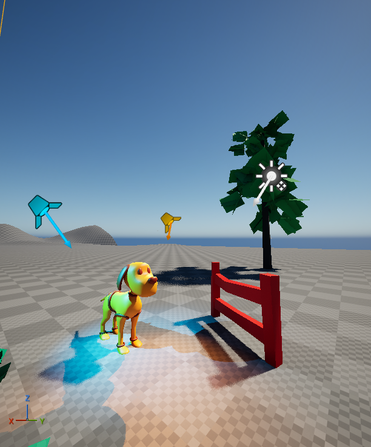
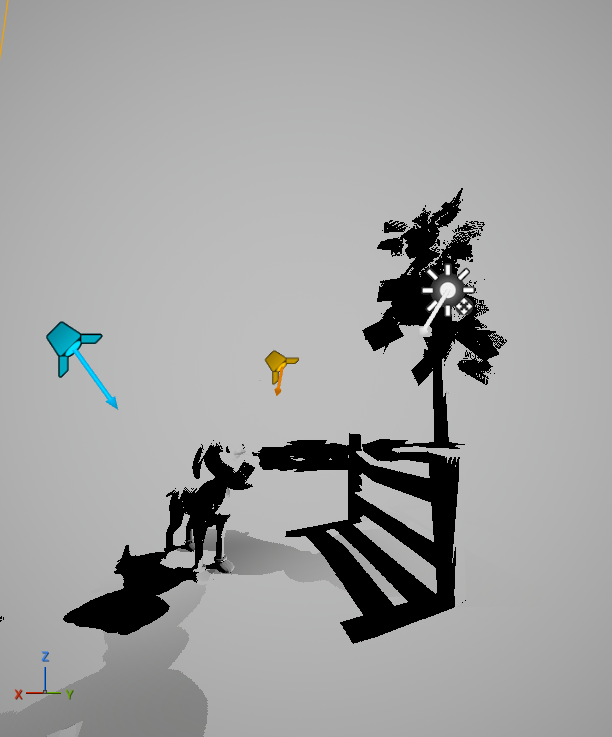
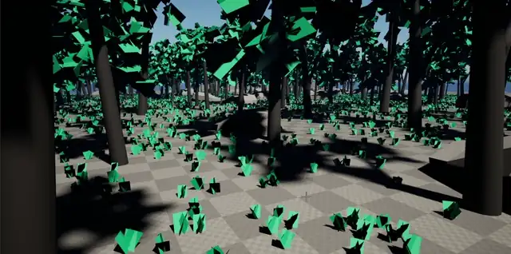
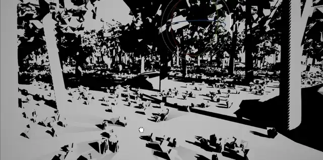
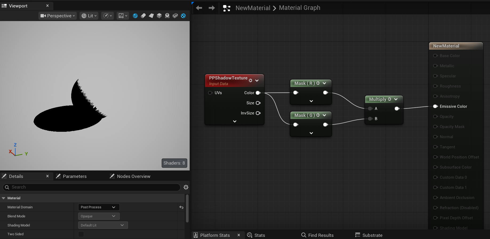

# PP Shadow Texture

Unreal Engine が描いたシャドウマップを再利用して、スクリーンスペースの影マスクをポストプロセスマテリアルから読めるようにするサンプルプラグインです。エンジン改造も、影の描き直しも行いません。

A sample plugin for Unreal Engine 5.8 that reuses the engine's own shadow maps (CSM / VSM / local light shadow maps) and publishes them as a screen-space mask for post process materials. No engine modification.

| 通常の表示（Lit） | `PPShadowTexture`（R × G） |
| :---: | :---: |
|  |  |

ディレクショナルライト 1 灯とローカルライト 2 灯を置いたシーンです。右は、同じ視点でマスクの R と G を掛けて表示しています。

## 出力

UserSceneTexture `PPShadowTexture`（R8G8、画面解像度）として公開します。値は 1 が光の当たっている状態、0 が影です。

| チャンネル | 内容 |
| --- | --- |
| R | メインのディレクショナルライトの影（CSM または VSM） |
| G | ローカルライト（ポイント / スポット / レクト）の影。各ライトがそのピクセルに届ける明るさで重み付けして 1 つにまとめた値 |

含まれるのはシャドウマップ由来のキャストシャドウだけです。N·L による陰は含まれません。

エンジンがそのフレームで描いたシャドウマップを読むので、エディターでライトを動かせばマスクも追従します。

ディレクショナルライトを回転させたところ（前半は通常の表示、後半は `PPShadowTexture` の表示）:



ポイントライトを追加して動かしたところ（`PPShadowTexture` の表示）:



## 動作環境

- Unreal Engine 5.8 専用（他のバージョンでは `static_assert` でビルドが止まります）
- Windows (Win64)、デスクトップのディファードレンダラー、SM5 以上
- ソースから導入する場合は C++ プロジェクト。ビルド済みバイナリは、インストール済みビルドの UE 5.8（ランチャー版など）で使えます

## 導入

### ビルド済みバイナリを使う

[Releases](https://github.com/historia-Inc/PPShadowTexture/releases) から `PPShadowTexture-<バージョン>-UE5.8-Win64.zip` を取得します。エディター用の DLL と、パッケージ用（Development / Shipping）のビルド済みオブジェクトが入っています。

1. zip を展開し、`PPShadowTexture` フォルダをプロジェクトの `Plugins/` に置きます。
2. エディタでプラグイン「PP Shadow Texture」を有効にします。

### ソースから導入する

このリポジトリをクローンします。

```bash
git clone https://github.com/historia-Inc/PPShadowTexture.git
```

1. 取得したフォルダをプロジェクトの `Plugins/PPShadowTexture/` に置きます。
2. プロジェクトをビルドします。
3. エディタでプラグイン「PP Shadow Texture」を有効にします。

## 使い方

ポストプロセスマテリアルに `PPShadowTexture` ノードを置きます。マテリアルエディタの右クリックメニューやパレットで `PPShadowTexture` と検索すると見つかります。出力ピンは UserSceneTexture ノードと同じで、`Color` の R と G を使います。



上は、R と G を掛けてそのまま表示するだけのマテリアルです（Material Domain は Post Process）。

このノードは、UserSceneTexture ノードの名前を `PPShadowTexture` に固定したものです。標準の UserSceneTexture ノードに名前 `PPShadowTexture` を指定しても、同じ結果になります。

読むマテリアルがないフレームでは、マスク生成のパスは RDG によってカリングされます。

| CVar | 既定値 | 内容 |
| --- | --- | --- |
| `r.PPShadowTexture.Enable` | 1 | 0 にするとマスクを公開しません |
| `r.PPShadowTexture.Log` | 0 | 1 にすると、ビューごとに見つかった影の種類をログに出します |

## 仕組み

1. PostOpaque のレンダーデリゲートで、レンダラーが保持しているシャドウ情報（`FProjectedShadowInfo`、VSM のユニフォームバッファ）を集めます。
2. コンピュートシェーダーで SceneDepth からワールド位置を復元し、シャドウマップと比較してマスクを作ります。
3. ポストプロセスの先頭（BeforeDOF）で、マスクを UserSceneTexture として登録します。

## 制限

- レイトレースシャドウ、Distance Field Shadow、コンタクトシャドウ、ベイクした影は含まれません。
- 影を受けるのは不透明のピクセルだけです（SceneDepth から位置を復元するため）。
- Renderer モジュールの非公開ヘッダに依存しているので、エンジンのバージョンごとに追従が必要です。
- モバイル、MSAA の深度バッファ、パストレーシングには対応していません。
- まとめて扱えるローカルライトは 64 個、カスケードは 16 枚までです。
- `PPShadowTexture` ノードは、新しいマテリアルトランスレータ（`r.Material.Translator.EnableNew`）には対応していません。その場合は標準の UserSceneTexture ノードを使ってください。

## ライセンスと配布について

ソースコードは [MIT License](LICENSE) です。
